# Master Plan & Blueprint: Integrasi Aplikasi Desktop, Server & DevOps

Dokumen ini memuat arsitektur dan peta jalan (*roadmap*) komprehensif untuk mengintegrasikan asisten Mochi (NotchBuddy) dengan aplikasi-aplikasi produktivitas, perkakas pengembangan perangkat lunak (IDE), serta infrastruktur server lokal/remote dan cloud.

---

## 1. Arsitektur Multi-Layer Integrasi

Untuk memastikan asisten dapat berkomunikasi dengan aplikasi tanpa memerlukan izin root berbahaya, sistem menggunakan 4 saluran protokol native:

```mermaid
flowchart TD
    Mochi["Mochi Autonomous Agent / Island"] --> Router["Integration & Tool Router"]
    
    subgraph Layer1["1. Desktop Apps (macOS Native)"]
        Router -->|"AppleEvents / AppleScript / JXA"| Office["Microsoft Office (Word, Excel, PPT)"]
        Router -->|"NSWorkspace / ScriptingBridge"| AppleApps["Apple Apps (Mail, Calendar, Reminders, Notes, Safari)"]
        Router -->|"Media Remote Framework"| Media["Spotify / Apple Music"]
    end

    subgraph Layer2["2. Developer Tools (Local)"]
        Router -->|"CLI & Workspace IPC"| IDE["VS Code / Xcode / Cursor / Windsurf"]
        Router -->|"Git Engine & gh CLI"| Git["Git & GitHub (Commit, PR, Review)"]
        Router -->|"AppleScript / TTY"| Terminal["iTerm2 / Terminal / tmux"]
    end

    subgraph Layer3["3. Server & DevOps (Local / Remote)"]
        Router -->|"Docker Engine Socket / CLI"| Docker["Docker Desktop / Podman"]
        Router -->|"SSH Ed25519 Encrypted Tunnel"| SSH["Remote Linux / Cloud Servers"]
        Router -->|"Kubernetes CLI (kubectl)"| K8s["Kubernetes Clusters"]
        Router -->|"Native DB Clients"| DB["Postgres / MySQL / SQLite / Redis"]
    end

    subgraph Layer4["4. Cloud & Gateway"]
        Router -->|"MCP Client (Model Context Protocol)"| MCP["MCP Servers (Stitch, GitHub, etc.)"]
        Router -->|"Encrypted Bot Gateway"| Telegram["Telegram Smartphone Gateway"]
    end
```

---

## 2. Rincian Paket Integrasi Per Kategori

### A. Kategori 1: Aplikasi Produktivitas & Kreatif macOS

| Target Aplikasi | Protokol Integrasi | Kapabilitas & Aksi yang Disediakan | Tool Name Rencana |
| :--- | :--- | :--- | :--- |
| **Microsoft Word** | AppleScript / OXML CLI | Baca dokumen aktif, cari kata, buat ringkasan, tambahkan paragraf/bab baru, ekspor ke PDF. | `word_read`, `word_write_paragraph`, `word_export_pdf` |
| **Microsoft Excel** | AppleScript / CSV bridge | Baca range cell/tabel, buat grafik otomatis, hitung formula, format tabel data keuangan. | `excel_read_range`, `excel_write_cells`, `excel_create_chart` |
| **Microsoft PowerPoint** | AppleScript | Buat slide baru dari outline teks, ganti judul/poin slide, jalankan presentasi. | `ppt_create_slide`, `ppt_update_text` |
| **Apple Calendar & Reminders** | EventKit native / Scripting | Baca jadwal hari ini, tambah pengingat tugas baru, setel alarm atau deadline rapat. | `calendar_list_events`, `reminder_add_task` |
| **Apple Notes & Mail** | ScriptingBridge / AppleEvents | Simpan catatan cepat ke Apple Notes, draf email di Apple Mail, cari pesan belum dibaca. | `notes_create_note`, `mail_draft_email` |
| **Spotify / Apple Music** | MediaRemote / Scripting | Putar musik fokus/lo-fi saat pengguna mulai bekerja, kontrol volume, next/pause. | `media_play_focus_music`, `media_control` |
| **Obsidian / Notion** | Local Markdown / REST API | Sinkronisasi catatan harian (Daily Notes), tambah to-do ke database Notion. | `obsidian_append_daily`, `notion_add_page` |

---

### B. Kategori 2: Developer & Coding Environment

| Target Aplikasi | Protokol Integrasi | Kapabilitas & Aksi yang Disediakan | Tool Name Rencana |
| :--- | :--- | :--- | :--- |
| **VS Code / Cursor / Windsurf** | CLI (`code`, `cursor`) / Hook | Buka proyek pada folder tertentu, navigasi ke file dan baris error (`code -g file:line`), trigger formatting. | `editor_open_project`, `editor_goto_line` |
| **Xcode** | AppleScript / `xcrun` / `xcodebuild` | Trigger build project, jalankan test suite, baca build logs, ekstrak error kompilasi. | `xcode_build_project`, `xcode_run_tests` |
| **Git & GitHub** | `git` binary + `gh` CLI | Cek git status, buat branch baru, commit dengan pesan otomatis cerdas, review PR, baca diff. | `git_status_check`, `git_smart_commit`, `gh_pr_review` |
| **iTerm2 / Terminal** | AppleScript TTY injection | Jalankan tugas berat di tab terminal terpisah agar pengguna bisa memantau live output terminal. | `iterm_run_in_tab`, `terminal_split_pane` |

---

### C. Kategori 3: Server, Container & Cloud Infrastructure

| Target Aplikasi | Protokol Integrasi | Kapabilitas & Aksi yang Disediakan | Tool Name Rencana |
| :--- | :--- | :--- | :--- |
| **Docker Desktop / Podman** | Docker Engine Socket / CLI | Cek status container (`docker ps`), baca logs error (`docker logs`), restart container mati, `docker-compose up/down`. | `docker_list_containers`, `docker_get_logs`, `docker_restart_container` |
| **Remote Server (SSH Gateway)** | SSH Client (`ssh -i ~/.ssh/id_ed25519`) | Audit kesehatan server jarak jauh (CPU, RAM, Disk, uptime), restart systemd service (Nginx/Node/Python), tail error log. | `ssh_server_health`, `ssh_run_command`, `ssh_tail_log` |
| **Kubernetes (`kubectl`)** | `kubectl` CLI | Cek status pod/deployment cluster, deskripsi event gagal, ambil log pod crash (`kubectl logs --tail=100`). | `k8s_get_pods`, `k8s_describe_pod`, `k8s_pod_logs` |
| **Database (Postgres, MySQL, Redis)** | Native CLI (`psql`, `mysql`, `redis-cli`) | Cek koneksi DB, jelajahi skema tabel, eksekusi query analitik aman (SELECT-only guardrail). | `db_inspect_schema`, `db_execute_safe_query` |
| **Cloud CLI (AWS / GCP / Cloudflare)** | `aws`, `gcloud`, `cloudflared` | Cek status VM instance, monitoring bucket storage S3/GCS, cek tunnel Cloudflare aktif. | `cloud_vm_status`, `cloud_tunnel_check` |

---

## 3. Matriks Keamanan & Guardrails (PolicyEngine)

Untuk menjaga integritas dan keamanan sistem laptop serta server pengguna:

1. **Read-Only / Non-Destructive Allowed**:
   - Pembacaan data, cek log, inspeksi status container, dan query `SELECT` database diizinkan berjalan secara otomatis (*Autopilot Mode*).
2. **Destructive / Write Protection (Human-In-The-Loop)**:
   - Aksi-aksi berisiko seperti `docker rm -f`, `DROP TABLE`, `DELETE`, `systemctl stop`, atau perintah SSH yang memodifikasi file konfigurasi server `/etc/` **wajib** memunculkan konfirmasi persetujuan di Notch dan Telegram (*PolicyVerdict.confirm*).
3. **Penyimpanan Kredensial**:
   - Seluruh SSH key path, API tokens, dan password database disimpan di **macOS Keychain Services** (`KeychainStore.swift`), tidak pernah disimpan dalam plain-text di berkas konfigurasi.

---

## 4. Rencana Jadwal Rilis Integrasi (Phased Roadmap)

- **Fase 1 (Selesai)**: Office Suite dasar (Word/Excel reader & writer), Git basic runner, Telegram Encrypted Gateway, Local Network Scanner, Webcam & CCTV Gateway.
- **Fase 2 (Berikutnya)**:
  - Docker Desktop Manager (`docker_list_containers`, `docker_get_logs`, `docker_restart_container`).
  - Remote Server SSH Health Sentinel (`ssh_server_health`, `ssh_tail_log`).
  - Apple Apps Suite (Calendar, Reminders, Notes via native bridges).
- **Fase 3**:
  - Kubernetes & Cloud Infrastructure Watcher (`k8s_get_pods`, `cloud_tunnel_check`).
  - Database Safe Query Explorer (`db_inspect_schema`, `db_execute_safe_query`).
  - IDE Deep Links (`code -g file:line`).

