# Master Plan & Roadmap Pengembangan Selanjutnya (Next-Gen Roadmap)

Dokumen ini memuat arsitektur dan peta jalan (*strategic roadmap*) pengembangan asisten Mochi (NotchBuddy) untuk fase berikutnya. Rencana ini dirancang untuk mengubah Mochi dari sekadar asisten cerdas desktop menjadi **Autonomous Desktop Operating Partner & Infrastructure Sentinel (JARVIS)** yang proaktif, berdaya persepsi tinggi, dan terintegrasi mendalam dengan workflow rekayasa perangkat lunak maupun DevOps.

---

## 1. Kilas Balik Status Kapabilitas Terkini (Baseline Saat Ini)

Semua pilar dari fase sebelumnya telah selesai diimplementasikan, diuji, dan lulus 100%:
- ✅ **Paket 1 - 4**: Dasar Asisten Notch Island, Dynamic Island FSM, Chat Multi-Provider, Claude Code Relay Hooks.
- ✅ **Paket 5**: Network Sentinel & Security Audit Suite (`laptop_security_audit`, `network_scan_lan`, `network_diagnostics`).
- ✅ **Paket 6**: Webcam Visual Perception (`camera_capture_photo`, `camera_analyze`, hardware green LED privacy).
- ✅ **Paket 7**: On-Device Biometric Face Recognition & Peeking Guard (`face_enroll_owner`, `face_verify_presence`).
- ✅ **Paket 8**: CCTV RTSP & IoT Streamer (`cctv_list_cameras`, `cctv_get_snapshot`, `cctv_add_camera`).
- ✅ **Paket 9**: Resilient Tool Calling Framework (Gemini OpenAPI Schema Sanitizer, zero-breakage array items, fuzzy aliasing).
- ✅ **Fase 2 Integrasi Server & Desktop**:
  - Docker Container Manager (`docker_list_containers`, `docker_get_logs`, `docker_restart_container`).
  - Remote Server SSH Gateway (`ssh_list_servers`, `ssh_server_health`, `ssh_run_command`, `ssh_tail_log`).
  - Apple Native Apps Suite (Calendar, Reminders, Notes, Spotify/Music).
  - Perbaikan layout chat truncation & integrasi Canvas otomatis untuk hasil kamera.

---

## 2. Peta Jalan Pengembangan Berikutnya (Paket 10 - 13)

```mermaid
flowchart TD
    MochiCore["Mochi Next-Gen Core"] --> P10["Paket 10: DevOps, Cloud & DB Command Center"]
    MochiCore --> P11["Paket 11: Proactive Sentry & Autonomy Watchers"]
    MochiCore --> P12["Paket 12: Real-Time Full-Duplex Voice 2.0"]
    MochiCore --> P13["Paket 13: Interactive Canvas Studio 2.0 & Siri"]

    subgraph P10Details["DevOps & DB Engine"]
        P10 --> K8s["Kubernetes Sentinel (kubectl)"]
        P10 --> DB["Database Safe Explorer (Postgres/MySQL/Redis)"]
        P10 --> Dev["Developer Workflow (Smart Git & IDE Goto-Line)"]
    end

    subgraph P11Details["Autonomous Watchers"]
        P11 --> AwaySentry["Physical Intruder Alert (Telegram + Webcam)"]
        P11 --> WiFiSentry["New LAN Device Watcher"]
        P11 --> SelfHeal["Container & Server Crash Auto-Healer"]
    end

    subgraph P12Details["Real-Time Voice"]
        P12 --> LiveStream["Gemini Live / WebRTC Sub-second Audio"]
        P12 --> SpatialEmotion["Emotion-Adaptive Vocalization"]
    end

    subgraph P13Details["Visual & Ecosystem"]
        P13 --> LiveCanvas["Canvas 2.0 (Interactive Widgets & HTML Preview)"]
        P13 --> FloatingHUD["Pin-to-Desktop Floating HUD"]
        P13 --> SiriIntents["Apple App Intents & Siri Shortcuts"]
    end
```

---

## 3. Rincian Paket Pengembangan

### 🚀 Paket 10: DevOps, Cloud & Database Command Center (Fase 3 Integrasi)

Membawa kapabilitas orkestrasi infrastruktur langsung ke desktop insinyur perangkat lunak dan DevOps:

1. **Kubernetes Cluster Sentinel (`KubernetesIntegrationService.swift`)**:
   - `k8s_get_pods`: Memantau status pod dan deployment per-namespace secara real-time (Running, Pending, CrashLoopBackOff).
   - `k8s_describe_pod` & `k8s_pod_logs`: Investigasi otomatis ketika pod mengalami crash, OOMKilled, atau restart berulang kali.
   - Presentasi ringkasan visual kesehatan cluster di Canvas.
2. **Database Safe Explorer Engine (`DatabaseIntegrationService.swift`)**:
   - Dukungan konektor: PostgreSQL (`psql`), MySQL (`mysql`), Redis (`redis-cli`), dan SQLite lokal.
   - `db_inspect_schema`: Membaca relasi tabel, tipe kolom, dan primary/foreign key.
   - `db_execute_safe_query`: Eksekusi query analitik berkecepatan tinggi dengan proteksi mutlak *Read-Only Guardrail* (hanya mengizinkan `SELECT`; perintah `UPDATE`/`DELETE`/`DROP` diblokir atau diwajibkan konfirmasi Human-In-The-Loop).
   - Hasil query otomatis disajikan dalam tabel interaktif Canvas yang dapat disortir dan dicari.
3. **Developer & Git Workflow Supercharger (`DeveloperEnvironmentService.swift`)**:
   - `editor_goto_file_line`: Membuka file dan melompat langsung ke baris kode yang error di Cursor, VS Code, atau Windsurf (`code -g path:line`).
   - `git_smart_commit`: Menganalisis diff perubahan staged/unstaged dan menghasilkan pesan commit sesuai standar Conventional Commits secara instan.
   - `gh_pr_review_summary`: Mengambil ringkasan Pull Request GitHub aktif dan menyajikan ulasan diff kode secara visual di Canvas.

---

### 🛡️ Paket 11: Proactive Sentry & Autonomous Health Watchers

Mentransformasi Mochi dari asisten reaktif (menunggu perintah) menjadi asisten proaktif yang menjaga sistem dan lingkungan secara mandiri:

1. **Physical Intruder & Anti-Theft Guard (Away Sentry Mode)**:
   - Ketika MacBook terkunci (*lock screen*) atau terdeteksi pengguna sedang meninggalkan meja kerja (`face_verify_presence == false` selama > 5 menit), sistem masuk ke status **Sentry Mode**.
   - Jika kamera mendeteksi ada wajah orang asing membuka laptop atau menatap layar di tempat umum/kafe, Mochi secara senyap memotret dan mengirimkan **Peringatan Keamanan Kritis ke Telegram** pemilik lengkap dengan foto pengintip, timestamp, dan nama Wi-Fi aktif.
2. **LAN New-Device Sentry (Wi-Fi Watcher Daemon)**:
   - Pemantau pasif jaringan Wi-Fi lokal berbasis perbedaan (*diff delta*) pemindaian ARP.
   - Jika terdeteksi perangkat asing baru (*unknown MAC/Vendor*) yang terhubung ke jaringan Wi-Fi rumah/kantor, Notch Island memunculkan Proactive Chip: *"⚠️ Perangkat asing baru terdeteksi di Wi-Fi: [IP / MAC / Vendor]"*.
3. **Container & Server Crash Auto-Healer**:
   - Daemon pemantau kesehatan server SSH dan Docker container setiap interval tertentu (5-10 menit).
   - Jika service penting mati (misal Nginx down atau container webapp exit tidak normal), Mochi memunculkan proaktif notifikasi di Notch: *"Container web-api berhenti (Exit Code 137). Ingin Mochi me-restart sekarang?"* dengan tombol aksi 1-klik `[ Restart ]`.

---

### 🎙️ Paket 12: Real-Time Full-Duplex Voice 2.0 (Conversational Live Stream)

Mencapai pengalaman bercakap-cakap yang setara dengan asisten masa depan:

1. **Streaming Audio Dua Arah Sub-Detik (Sub-second Audio Duplex)**:
   - Mengintegrasikan API multimodal streaming real-time (seperti Google Gemini Live Multimodal API / WebRTC Audio Stream).
   - Mengeliminasi jeda "tunggu AI selesai berpikir baru berbicara". Asisten mulai merespons suara dalam waktu < 400ms.
   - Kemampuan interupsi alami (*Barge-in*): Pengguna dapat menyela Mochi di tengah kalimat secara mulus tanpa membuat asisten kebingungan.
2. **Emotion & Context-Adaptive Vocalization**:
   - Modulasi intonasi suara yang adaptif: nada berbisik/lembut saat malam hari, nada tegas dan cepat saat ada alert server crash, nada ramah dan ceria saat sapaan pagi.

---

### 🎨 Paket 13: Interactive Canvas Studio 2.0 & Apple Ecosystem (Siri & Shortcuts)

Meningkatkan kenyamanan visual dan keterhubungan dengan ekosistem Apple:

1. **Interactive Widgets & Live Code Sandbox di Canvas**:
   - Canvas tidak hanya menampilkan teks Markdown dan grafik statis, melainkan mendukung kontrol interaktif: form input, filter dropdown data tabel, slider numerik, dan render preview HTML/JS/CSS interaktif secara langsung.
2. **Pin-to-Desktop & Canvas Floating HUD**:
   - Kemampuan menyematkan jendela Canvas di pojok layar monitor (floating HUD dengan transparansi dinamis) sehingga pengguna dapat memantau log server, grafik monitoring, atau instruksi riset sambil terus coding di IDE utama.
3. **Apple App Intents & Siri Shortcuts Integration**:
   - Menyediakan `MochiAppIntents` agar pengguna dapat memanggil kapabilitas Mochi via suara Siri ("Hey Siri, tanya Mochi...") atau merangkaikan aksi Mochi ke dalam aplikasi Shortcuts macOS bawaan.

---

## 4. Prioritas Eksekusi yang Direkomendasikan (Urutan Implementasi)

| Tahap | Fokus Utama | Nilai Tambah Pengguna | Estimasi Usaha |
| :---: | :--- | :--- | :---: |
| **Tahap 1** | **Paket 10: Database Safe Explorer & Git/IDE Workflows** | Produktivitas harian developer melonjak: query DB cepat tanpa tool berat, smart commit otomatis, buka baris error di IDE. | Sedang |
| **Tahap 2** | **Paket 11: Intruder Sentry (Telegram Alert) & Auto-Healer** | Nilai keamanan tinggi: MacBook aman saat ditinggal di kafe/kantor, server/container crash terdeteksi dan pulih otomatis. | Sedang |
| **Tahap 3** | **Paket 13: Interactive Canvas 2.0 & Floating HUD** | Visualisasi data server dan hasil riset semakin interaktif dan nyaman digunakan untuk multitasking. | Sedang |
| **Tahap 4** | **Paket 12: Real-Time Voice Duplex 2.0 (Gemini Live)** | Pengalaman komunikasi suara sekelas JARVIS dengan latensi ultra-rendah dan interupsi alami. | Kompleks |

---

## 5. Rencana Aksi Segera (Next Immediate Action)

Untuk melanjutkan implementasi, langkah yang paling berdampak langsung bagi produktivitas adalah **Paket 10 (DevOps, Cloud & Database Command Center)**:
1. Membangun `DatabaseIntegrationService.swift` (Postgres, MySQL, SQLite, Redis) dengan read-only guardrail.
2. Membangun `DeveloperEnvironmentService.swift` (`editor_goto_file_line`, `git_smart_commit`, `gh_pr_review_summary`).
3. Mendaftarkan alat ke `ToolExecutor.swift` dan membuat unit test suite untuk memastikan zero-regression.

