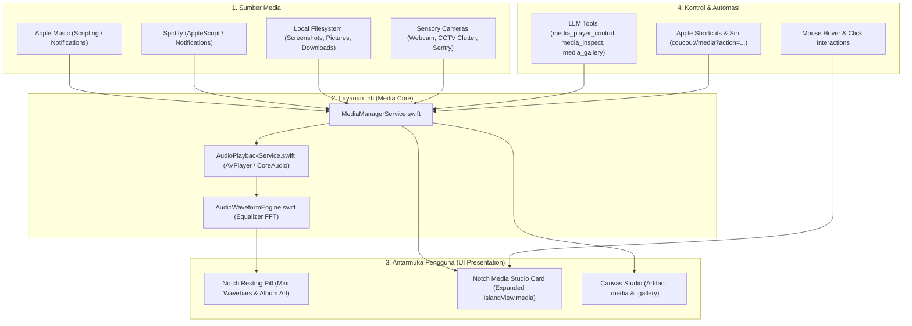

# Master Plan & Blueprint: Dynamic Island Media Studio, Gallery & Multi-Format Player

Dokumen ini memuat arsitektur, desain interaksi antarmuka (*UI/UX*), dan peta jalan implementasi untuk menghadirkan **Media Studio & Player** interaktif langsung di dalam **Notch Island (MacBook Dynamic Island)** dan **Canvas Studio 2.0**.

---

## 1. Visi & Tujuan Utama

Menjadikan notch MacBook bukan hanya sekadar area hitam pasif, melainkan **Dynamic Island Media Hub** yang hidup, interaktif, dan memukau:
1. **Dynamic Media Pill (Resting / Compact Mode)**:
   - Saat musik berputar atau video diputar, Notch Island memanjang secara anggun (*fluid morphing*).
   - Di sisi kiri notch: mini album art / ikon media berputar perlahan.
   - Di sisi kanan notch: **Live Audio Waveform Bars** (equalizer mini yang berdenyut dinamis mengikuti ketukan musik).
   - Mengarahkan kursor (*hover*) atau klik pada notch akan langsung memunculkan mini quick-controller.
2. **Expanded Island Media Studio (`IslandView.media`)**:
   - Tampilan visual mewah di dalam Notch Island yang mencakup:
     - **Music Player Card**: Cover art dengan ambient glow blur, judul lagu & artis *running text*, scrubber durasi waktu, visualizer spektrum frekuensi penuh, tombol Play/Pause/Skip/Shuffle/Repeat, volume slider, dan indikator sumber (Spotify / Apple Music / File Lokal).
     - **Video Player & Clip Replay Card**: Pemutar video native (`AVPlayer`) untuk review rekaman layar, video klip CCTV/keamanan, atau file MP4/MOV langsung di dalam notch.
     - **Image Viewer & Quick Inspect Card**: Penampil foto/screenshot dengan thumbnail carousel strip, zoom in/out, info resolusi/ukuran, tombol salin gambar, dan opsi ekspansi ke Canvas.
3. **Ekspansi ke Canvas Studio 2.0**:
   - Tombol 1-klik untuk mentransfer media dari Notch Island ke jendela **Canvas Studio** (tipe artifact baru: `.media` dan `.gallery`) untuk inspeksi resolusi penuh atau galeri kisi-kisi foto (*multi-column grid lightbox*).
4. **Universal Media Hub**:
   - Mengontrol aplikasi pihak ketiga (Spotify, Apple Music, QuickTime) sekaligus memutar file media lokal (`.mp3`, `.m4a`, `.wav`, `.mp4`, `.mov`, `.png`, `.jpg`, `.webp`, `.heic`, `.gif`).

---

## 2. Arsitektur Komponen & Alur Data



---

## 3. Rincian Desain Antarmuka Notch Island

### A. Compact / Resting Mode (Saat Media Aktif di Latar Belakang)
Ketika asisten berada dalam mode resting/compact dan ada audio/video yang sedang diputar:
- **Ukuran Notch**: Melebar dari ukuran standar notch (~180px) menjadi **248px** dengan transisi spring halus (*fluid morphing*).
- **Elemen Kiri Notch**:
  - Mini album art / poster film lingkaran berukuran 18×18 px dengan border tipis 0.5px putih transparan.
  - Jika tidak ada cover art, menampilkan ikon animated musical note atau video reel.
- **Elemen Kanan Notch**:
  - **Live Equalizer Wavebars**: 4 batang vertikal berukuran lebar 2.5px dengan warna adaptif (menyesuaikan warna dominan cover album art). Batang bergerak naik-turun secara mulus dengan variasi tinggi 3px s.d. 14px.
- **Interaksi Hover / Klik**:
  - Hover: Menampilkan tooltip judul lagu & artis sekilas.
  - Klik: Mengembangkan Notch Island langsung ke mode **Expanded Media Studio** (`.media`).

```
+--------------------------------------------------------------+
|   [ 🎵 Album Art ]        ===== NOTCH =====      [ |||| Wave ] |
+--------------------------------------------------------------+
```

---

### B. Expanded Mode: Music Player Card
Ketika Notch Island dikembangkan ke tampilan media:

```
+-------------------------------------------------------------------------+
|  🎵 NOW PLAYING                             [ Spotify / Apple Music ] ✕ |
|                                                                         |
|  +---------+   Judul Lagu Yang Sangat Panjang Berjalan... ◀▶            |
|  |         |   Nama Artis • Nama Album (2026)                           |
|  |  Cover  |                                                            |
|  |   Art   |   01:42 ━━━━━━━●━━━━━━━━━━━━━━━━━━━━━━━━━━━━━ 03:45       |
|  |  64x64  |                                                            |
|  +---------+   [ 🔀 ]    [ ⏮️ ]    [ ⏯️ ]    [ ⏭️ ]    [ 🔁 ]             |
|                                                                         |
|  Volume: 🔈 ━━━━━━━━━●━━━━ 🔊            [ ↗ Buka di Canvas Studio ]    |
+-------------------------------------------------------------------------+
```

- **Cover Art Ambient Blur**: Bayangan cahaya lembut (*ambient glow*) di belakang cover art yang memancarkan warna dominan album.
- **Marquee Text**: Judul lagu panjang berjalan perlahan secara horizontal agar teks tidak terpotong.
- **Scrubbing Bar**: Bilah waktu lagu interaktif yang menampilkan waktu berjalan dan total durasi, dapat digeser untuk melompat ke detik tertentu (*seek*).
- **Kontrol Playback Lengkap**: Shuffle, Previous, Play/Pause, Next, dan Repeat.
- **Volume & Source Selector**: Pengatur level suara mandiri dan tombol pilih sumber media (Spotify, Apple Music, File Lokal).

---

### C. Expanded Mode: Video Player & Clip Replay Card
Untuk memutar file video lokal, rekaman layar, atau klip keamanan:
- **Embedded AVPlayer**: Video diputar dengan rasio 16:9 di sisi kiri/tengah notch berukuran 160×90 px dengan sudut membulat (*corner radius 10px*).
- **Kontrol Playback**: Tombol Play/Pause mengambang di atas video saat kursor berada di atasnya (*hover overlay*), bilah scrubber durasi, dan tombol toggle mute.
- **Fitur Ekstra**:
  - Tombol **"Loop Clip"** untuk rekaman berulang (cocok untuk inspeksi rekaman CCTV atau animasi GIF/MP4).
  - Tombol **"Ekspansi ke Canvas"** untuk menonton dalam ukuran 600×340 px atau fullscreen.

---

### D. Expanded Mode: Image Viewer & Quick Gallery Card
Untuk melihat tangkapan layar terbaru, foto hasil jepretan webcam, atau diagram arsitektur:
- **Preview Gambar Terpusat**: Gambar ditampilkan dengan aspek rasio asli, terpusat rapi dengan latar belakang gelap kontras tinggi.
- **Informasi Metadata Ringkas**:
  - Nama file, dimensi piksel (misal `1920 × 1080 px`), ukuran file (misal `1.2 MB`), dan format (`PNG`).
- **Aksi Cepat 1-Klik**:
  - 📋 **Salin Gambar**: Menyalin bitmap gambar langsung ke clipboard macOS.
  - 🔍 **Buka di Canvas**: Membuka gambar di Canvas Studio dengan fitur zoom hingga 400% dan filter.
  - 📂 **Tampilkan di Finder**: Melompat ke lokasi file di Finder (`revealInFinder`).
- **Mini Carousel Strip**: Menampilkan 4-5 thumbnail gambar terbaru di bawah preview untuk berpindah gambar secara instan.

---

## 4. Rincian Paket Pengerjaan (Implementation Roadmap)

Untuk mewujudkan fitur ini secara bertahap dan teruji tanpa mengganggu stabilitas sistem yang sudah ada, implementasi dibagi menjadi 4 tahap:

### 📦 Tahap A: Media Manager Core & Audio Playback Service
1. **`MediaManagerService.swift`**:
   - Mendeteksi pemutar aktif di macOS: Apple Music & Spotify via `DistributedNotificationCenter` dan AppleScript bridge.
   - Mengambil metadata lagu aktif: Judul, Artis, Album, Durasi, Posisi Berjalan, State (Playing/Paused), dan Artwork (NSImage/URL).
   - Pengelola file media lokal: Memindai folder `~/Desktop`, `~/Pictures/Screenshots`, `~/Downloads`, dan artifacts.
2. **`AudioPlaybackService.swift`**:
   - Pemutar file audio lokal (`AVAudioPlayer` / `AVPlayer`) untuk file MP3, WAV, AAC, FLAC, M4A.
   - Kontrol playback: `play(url:)`, `pause()`, `resume()`, `stop()`, `seek(to:)`, `setVolume(_:)`.
3. **`AudioWaveformEngine.swift`**:
   - Generator animasi spektrum gelombang frekuensi audio dinamis (4 level wavebars untuk resting notch, dan 16 frequency bars untuk expanded player).

---

### 📦 Tahap B: Notch Island Media UI (Resting & Expanded Card)
1. **Pembaruan `IslandTypes.swift` & `IslandRootView.swift`**:
   - Menambahkan `IslandView.media` ke enum view.
   - Menambahkan state pemutar aktif di `AppState.swift` (`activeMediaItem`, `isPlayingMedia`, `mediaProgress`).
   - Morphing lebar Notch Resting dari ~180px menjadi 248px saat media aktif dengan indikator live wavebars dan mini album art.
2. **Komponen UI SwiftUI Baru (`NotchMediaStudioView.swift`)**:
   - `NotchMusicPlayerCard`: Komponen cover art glow, marquee text, interactive scrubber, tombol kontrol, dan wavebars.
   - `NotchVideoPlayerCard`: Mini `AVPlayerView` terintegrasi dengan overlay controls.
   - `NotchImageViewerCard`: Preview foto, badge resolusi, tombol salin clipboard, dan carousel thumbnail.

---

### 📦 Tahap C: Canvas Studio 2.0 Integration (Artifact `.media` & `.gallery`)
1. **Tipe Artifact Baru di `CanvasArtifact.swift`**:
   - `.media` ("Media Studio", icon `play.rectangle.fill`): Pemutar audio/video layar lebar di Canvas dengan waveform penuh, lirik/catatan track, dan pemilih playlist.
   - `.gallery` ("Galeri Media", icon `photo.on.rectangle.angled`): Grid multi-kolom foto/screenshot dengan fitur filter kategori, sortir tanggal, dan modal lightbox.
2. **Pembaruan `CanvasView.swift`**:
   - Renderer `canvasMediaStudioView(content:)` untuk audio/video player layar lebar.
   - Renderer `canvasGalleryGridView(content:)` untuk galeri gambar interaktif.

---

### 📦 Tahap D: Registrasi Tools LLM & Apple Shortcuts
1. **Pendaftaran Tools Baru di `ToolExecutor.swift`**:
   - `media_player_control`: Kontrol pemutar (`action`: play, pause, toggle, next, previous, seek, volume, source).
   - `media_inspect_file`: Menganalisis file foto/video/audio dan menampilkan kartu interaktifnya di Notch Island.
   - `media_present_gallery`: Menampilkan galeri foto/media lokal ke Canvas Studio.
   - `media_list_recent`: Menemukan daftar rekaman layar, screenshot, atau lagu terbaru.
2. **Aliases Sinonim**: `player_control`, `play_music`, `inspect_image`, `open_gallery`, `play_video`.
3. **Routing URL Scheme (`coucou://media`)**:
   - Mendukung perintah dari Shortcuts: `coucou://media?action=play`, `coucou://media?action=pause`, `coucou://media?inspect=/path/to/file.png`.

---

## 5. Rencana Pengujian (Test Strategy)

| No | Kode Pengujian | Skenario Uji | Kriteria Sukses |
| :---: | :--- | :--- | :--- |
| **1** | `T1: testMediaManagerMetadata` | Deteksi metadata Apple Music / Spotify / File Lokal. | Judul, artis, durasi terurai dengan benar tanpa memblokir thread. |
| **2** | `T2: testAudioWaveformEngine` | Kalkulasi tinggi batang equalizer 4-bar dan 16-bar. | Nilai normalisasi berada di rentang 0.0 s.d. 1.0 secara kontinu. |
| **3** | `T3: testNotchMorphingAndLayout` | Dimensi notch saat media aktif (lebar 248px pada compact mode). | ViewLayout untuk `.media` terdaftar dan ukuran proporsional. |
| **4** | `T4: testCanvasMediaArtifacts` | Tipe `.media` dan `.gallery` pada `CanvasArtifact`. | Display name, ikon, dan ekspor bekerja dengan mulus. |
| **5** | `T5: testToolRegistrationAndOpenAPI` | Registrasi tools media baru di `ToolExecutor`. | Skema JSON OpenAPI 100% valid tanpa missing array items. |

---

## 6. Jadwal & Estimasi Eksekusi

Rencana ini siap dieksekusi secara terstruktur:
1. **Langkah 1**: Pembuatan fondasi model & service (`MediaManagerService.swift`, `AudioPlaybackService.swift`, `AudioWaveformEngine.swift`).
2. **Langkah 2**: Pembuatan UI Notch Island (`NotchMediaStudioView.swift` & integrasi ke `IslandViewContent.swift`, `IslandRootView.swift`).
3. **Langkah 3**: Integrasi Canvas Studio 2.0 (`.media` & `.gallery`).
4. **Langkah 4**: Pendaftaran LLM Tools, test suite, build Xcode, dan pembaruan dokumen.

