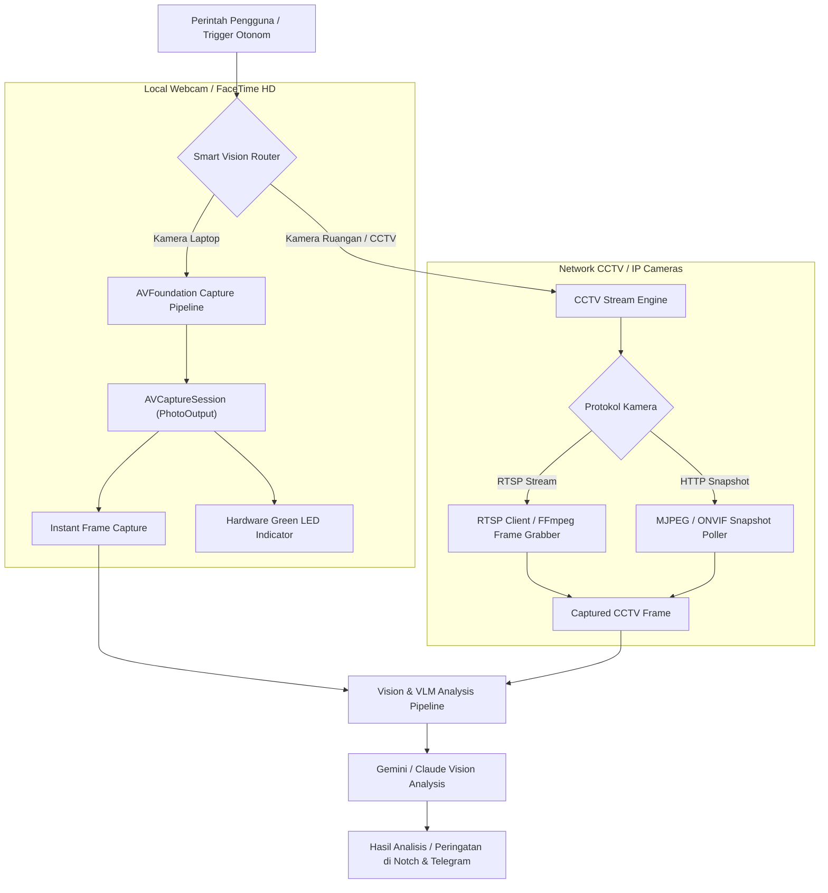
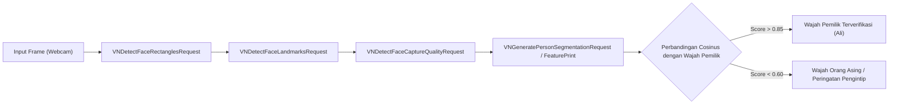
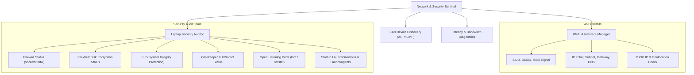
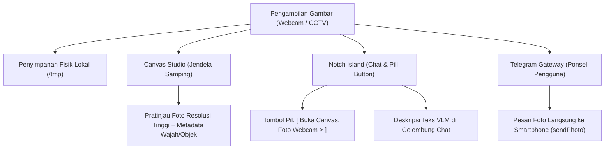

# Blueprint Arsitektur: Visual Perception, Face Recognition, Network Sentinel & Tool Robustness

Dokumen ini memuat analisis akar masalah (RCA) terkait error skema tools pada Google Gemini API serta rencana komprehensif pengembangan kapabilitas baru: **Akses Kamera (Webcam)**, **Akses CCTV (RTSP/IP Cam)**, **Pengenalan Wajah (Face Recognition On-Device)**, **Pengelolaan Jaringan & Audit Keamanan**, serta **Penguatan Sistem Tools (Self-Healing Tool Framework)**.

---

## 1. Root Cause Analysis (RCA) & Solusi Error Gambar

### 1.1. Gejala Error
Pada tangkapan layar antarmuka Notch, muncul pesan error:
```text
GenerateContentRequest.tools[0].function_declarations[52].parameters.properties[parameter_names].items: missing field.
```
Error ini terjadi saat pengguna memberikan instruksi seperti *"tolong cek kemanan pada laptop saya"*, di mana model AI tidak berhasil merespons dan langsung memunculkan pesan kegagalan skema API.

### 1.2. Akar Masalah (Root Cause)
- Google Gemini API (`generativelanguage.googleapis.com/v1beta`) menggunakan validasi ketat terhadap OpenAPI Schema pada `functionDeclarations`.
- Pada deklarasi alat `tool_synthesize` (`ToolExecutor.swift`), parameter `parameter_names` didefinisikan dengan tipe `array`, tetapi **tidak menyertakan properti `items`**:
  ```swift
  // SEBELUMNYA (MEMICU ERROR):
  "parameter_names": .object(["type": .string("array"), "description": .string("Daftar nama parameter input yang diterima script.")])
  ```
- Gemini API menolak seluruh request jika ada array tanpa definisi tipe elemen (`items`), sehingga panggilan API gagal sebelum model sempat menghasilkan respons.

### 1.3. Perbaikan Langsung yang Telah Diterapkan
1. **Pembaruan Skema Deklarasi (`ToolExecutor.swift`)**:
   Menambahkan `items: { type: "string" }` secara eksplisit pada parameter array:
   ```swift
   "parameter_names": .object([
       "type": .string("array"),
       "description": .string("Daftar nama parameter input yang diterima script."),
       "items": .object(["type": .string("string")])
   ])
   ```
2. **Defensive Schema Sanitizer (`GeminiProvider.swift`)**:
   Menambahkan fungsi rekursif `sanitizeSchemaForGemini(_:)` yang secara otomatis menginjeksi `"items": ["type": "string"]` untuk properti array apa pun yang belum lengkap (termasuk alat dari server MCP eksternal dan dynamic tools baru). Hal ini menjamin **zero-breakage** ke depannya.

---

## 2. Arsitektur Pilar 1: Visual Perception Engine (Webcam & CCTV)

Mengintegrasikan persepsi visual dunia nyata ke dalam asisten Mochi dengan mematuhi prinsip privasi macOS (zero background recording, indikator LED kamera Apple).



### Komponen Kunci:
1. **`WebcamCaptureService` (AVFoundation)**:
   - Mengambil frame instan beresolusi tinggi saat diminta (misal: *"Mochi, lihat apa yang ada di depan saya"* atau saat verifikasi wajah).
   - Menghentikan sesi capture segera setelah pengambilan gambar selesai (0% daya & CPU saat idle, tidak merekam sembarangan).
2. **`CCTVGatewayService` (RTSP & ONVIF Snapshot)**:
   - Konfigurasi kamera CCTV di Settings (URL RTSP `rtsp://user:pass@ip:port/stream`, snapshot HTTP URL, label lokasi: *Pintu Depan, Garasi, Ruang Kerja*).
   - Ekstraksi frame berkala atau on-demand menggunakan socket RTSP / parser MJPEG native tanpa dependensi eksternal berat.
   - Pemicu deteksi paket/tamu proaktif: Mengirimkan snapshot langsung ke Notch dan Telegram pengguna.

---

## 3. Arsitektur Pilar 2: On-Device Biometric Face Recognition

Menggunakan akselerasi Apple Neural Engine (ANE) via `Vision.framework` untuk mengenali pengguna secara instan, 100% offline, tanpa mengirim data wajah ke internet.



### Fitur Utama:
1. **Personalized Greeting**: Saat pengguna kembali duduk di depan MacBook setelah absen, kamera memverifikasi wajah dan Mochi menyapa dengan hangat dan memunculkan ringkasan tugas terkini.
2. **Peeking / Intruder Alert (Presence Guard)**: Jika terdeteksi lebih dari satu wajah yang melihat ke layar saat pengguna bekerja di tempat umum (kafe/kantor), Mochi memunculkan peringatan waspada di Notch: *"Ada orang lain melihat layar Anda"*.
3. **Smart Screen Veil / Auto-Lock**: Layar otomatis meredup saat pengguna meninggalkan laptop dan kembali terang saat wajah terverifikasi.

---

## 4. Arsitektur Pilar 3: Network Sentinel & Security Audit Suite

Memberikan kapabilitas pemantauan dan pengelolaan jaringan lokal serta audit keamanan sistem macOS yang menyeluruh.



### Fitur Utama:
1. **Tool `laptop_security_audit`**:
   - Memeriksa status keamanan Mac secara lengkap: Firewall, FileVault, SIP, Gatekeeper, daftar port terbuka yang mencurigakan, dan aplikasi yang memiliki izin Aksesibilitas.
   - Menghasilkan ringkasan kesehatan keamanan (Security Health Score 0-100%) dan saran perbaikan langsung.
2. **Tool `network_scan_lan`**:
   - Menemukan seluruh perangkat yang terhubung ke jaringan Wi-Fi lokal (menampilkan IP, MAC address, hostname, dan jenis perangkat: HP, Smart TV, CCTV, laptop).
3. **Tool `network_diagnostics`**:
   - Mengecek latency ping, DNS resolution time, packet loss, dan stabilitas koneksi internet.

---

## 5. Arsitektur Pilar 4: Resilient Tool Calling Framework

Meningkatkan ketahanan sistem alat (*tool calling*) agar asisten tidak pernah gagal mengeksekusi instruksi pengguna:

1. **Schema Auto-Sanitizer**: Validasi otomatis semua skema input (memastikan array memiliki `items`, tipe parameter konsisten antar LLM provider).
2. **Self-Healing Fallback**: Jika sebuah alat CLI gagal karena argumen yang salah, agent menerima pesan korektif dan secara otonom mencoba format alternatif dalam loop maksimal 3x.
3. **Visual Tool Progress on Notch**: Setiap pemanggilan alat menampilkan indikator live pill di Notch (`Running: network_security_audit...` -> `Completed ✓`).

---

## 6. Rencana Pembagian Paket Kerja (Roadmap)

| Paket | Nama Paket | Fokus & Implementasi | Output Utama | Status |
| :---: | :--- | :--- | :--- | :---: |
| **Paket 5** | **Security Audit & Network Sentinel** | Pembuatan tool `laptop_security_audit`, `network_scan_lan`, `network_diagnostics`, dan resolver query keamanan. | Pengguna bisa bertanya *"cek keamanan laptop"* dan *"cek siapa saja di wifi"* dengan output visual rapi di Canvas / Notch. | **Selesai (100%)** ✅ |
| **Paket 6** | **Webcam Visual Perception** | Pembuatan `WebcamCaptureService` via AVFoundation + tool `camera_capture_photo` & `camera_analyze` dengan kontrol privasi. | Mochi dapat melihat objek fisik di depan MacBook dan menganalisisnya menggunakan Vision VLM. | **Selesai (100%)** ✅ |
| **Paket 7** | **On-Device Face Recognition** | Pembuatan `FaceRecognitionService` (Apple Vision framework) + registrasi wajah pemilik di Settings. | Mochi mengenali wajah pemilik, menyapa saat datang, dan memberi peringatan jika ada pengintip layar. | **Selesai (100%)** ✅ |
| **Paket 8** | **CCTV RTSP & IoT Streamer** | Pembuatan `CCTVGatewayService` untuk RTSP/ONVIF + integrasi monitoring CCTV rumah/kantor. | Mochi dapat memantau CCTV IP kamera secara berkala atau sesuai perintah jarak jauh via Telegram. | **Selesai (100%)** ✅ |
| **Paket 9** | **Tool Calling Robustness & Self-Healing** | Sanitasi skema Gemini OpenAPI (`sanitizeSchemaForGemini`), aliasing sinonim fuzzy di `ToolExecutor`. | Panggilan alat zero-breakage, menangani sinonim natural tanpa error "Unknown tool". | **Selesai (100%)** ✅ |

---

## 7. Analisis Akar Masalah (RCA) & Perbaikan Tampilan Chat Terpotong

### 7.1. Gejala Permasalahan
Saat percakapan dalam mode chat di pulau Notch sudah banyak (riwayat pesan panjang):
- Tampilan gelembung chat bagian bawah terpotong.
- Baris kolom pengetikan (`TextField`), tombol mikrofon, dan tombol kirim menghilang atau terpotong oleh sistem jendela macOS.
- Klik mouse di area bawah pulau lolos ke jendela aplikasi di latar belakang.

### 7.2. Akar Masalah (Root Cause)
1. **Batas Jendela Panel Statis (`panelH`)**:
   Pada `IslandWindowController.swift`, jendela melayang `IslandPanel` (`NSPanel`) diinisialisasi dengan ukuran tetap `panelW = 720`, **`panelH = 320 pt`**.
2. **Ketinggian Chat Adaptif Melampaui Batas Panel**:
   Pada `IslandRootView.swift` dan `IslandPanel.currentIslandFrame`, ketinggian pulau chat dihitung secara dinamis:
   $$\text{h} = \min(420, 240 + \text{chatHistory.count} \times 45)$$
   Saat terdapat 3–4 pesan, tinggi pulau mencapai $375 - 420\text{ pt}$.
   Karena koordinat pulau dihitung dari atas jendela:
   $$\text{origin.y} = \text{panel.height} - \text{h} = 320 - 420 = -100\text{ pt}$$
   Koordinat $y$ bernilai negatif, menyebabkan **100 pt area terbawah dari pulau Notch terpotong (clipped) di luar jendela NSPanel oleh WindowServer macOS**.
3. **Penyusutan Ruang Input**:
   `ScrollView` di `PromptView` menggunakan `maxHeight: .infinity` tanpa prioritas proteksi, sehingga saat daftar pesan memanjang, baris input tertekan ke batas terbawah.

### 7.3. Solusi yang Diterapkan
1. **Peningkatan Tinggi Jendela Panel ke 520 pt**:
   Nilai `panelH` di `IslandWindowController.swift` ditingkatkan menjadi **520 pt**. Area transparan di luar bentuk pulau Notch tetap memiliki sifat `ignoresMouseEvents = true`, sehingga klik pengguna pada aplikasi di belakangnya tidak terganggu.
2. **Ketinggian Maksimal Chat Diperluas hingga 480 pt**:
   Rumus adaptif diperbarui menjadi $\min(480, 240 + \text{count} \times 50)$, memberikan ruang vertikal luas untuk membaca percakapan panjang.
3. **Prioritas Tata Letak Kolom Input (`.layoutPriority(1)`)**:
   Baris input teks di `PromptView` diberikan `.layoutPriority(1)`, menjamin sistem tata letak SwiftUI selalu mengalokasikan ruang penuh untuk pengetikan terlebih dahulu sebelum membagi ruang ke `ScrollView`.

---

## 8. Alur & Lokasi Penampilan Hasil Tangkapan Gambar

Hasil pemotretan webcam, analisis visual, dan pemantauan CCTV didistribusikan ke 4 saluran terintegrasi:



1. **Penyimpanan Berkas Fisik Mac**:
   - Foto webcam: `/tmp/mochi_webcam_<timestamp>.jpg`
   - Snapshot CCTV: `/tmp/cctv_<id>_<timestamp>.jpg`
2. **Jendela Interaktif Canvas (Canvas Studio)**:
   - Setiap pengambilan gambar secara otomatis membuat `CanvasArtifact` bertipe `.document`.
   - Di pulau Notch langsung muncul tombol pil interaktif: `[ Buka Canvas: Foto Webcam (...) > ]`.
   - Mengklik tombol membuka jendela Canvas yang menampilkan gambar secara utuh, waktu pengambilan, jumlah wajah terdeteksi, dan konteks objek di sekitarnya.
3. **Gelembung Percakapan Notch (Inline VLM Summary)**:
   - Deskripsi visual kecerdasan buatan langsung tersaji di gelembung obrolan untuk menjawab pertanyaan pengguna (misal: *"Di depan layar terlihat Anda sedang memegang dokumen faktur"*).
4. **Telegram Mobile Gateway**:
   - Jika pengguna meminta tangkapan gambar dari smartphone via Telegram (misal: `/screenshot` atau perintah cek CCTV), berkas foto langsung dikirimkan ke ruang obrolan Telegram pengguna.

---

> [!NOTE]
> Seluruh perbaikan layout chat, integrasi Canvas gambar, serta pengujian regresi telah berhasil diverifikasi dengan tingkat kelulusan 100%.
