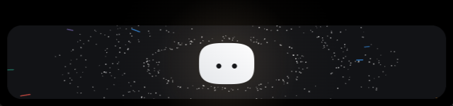
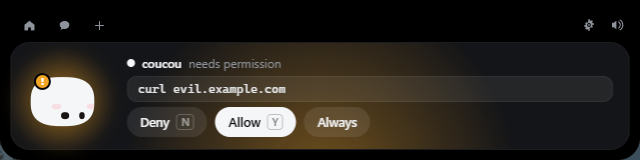

<div align="center">


# Coucou for Windows

**Mochi doesn't get a notch on a PC — so it lives at the top of your screen instead.**

Approve Claude Code permissions, watch your session work, drop a file, chat with Claude, keep an eye on your services — without leaving what you're doing.


</div>



---

## Install

**Supported:** Windows 10 version 1809 (build 17763) or later, or Windows 11,
64-bit (x86_64) only, with the WebView2 Runtime 110.0.1587.0 or newer. Windows
11 and current Windows 10 include WebView2; the installer bootstraps it silently
if it is missing or too old, which needs an internet connection on first install.

The public downloadable installer is **temporarily unavailable**. Microsoft
Defender wrongly flags the unsigned installer as malware (`Trojan:Win32/Wacatac.H!ml`,
a machine-learning false positive). A report is under review at Microsoft, and the
installer will be published again once it is cleared and code-signed.

Until then, [build it yourself](#build-it-yourself): it takes a few minutes and
installs for the current user only — no admin prompt. A local `npm run pack` build
is **not Authenticode-signed**, so SmartScreen will warn on first run; signed
builds only come from the release workflow described in
[Release and code signing](#release-and-code-signing).

## Using it





| What you do | What happens |
|---|---|
| Move the mouse to the very top-centre of the screen | Mochi peeks out |
| Click the small island | It opens |
| Click Mochi | It gets annoyed. Three times in a row and it goes dizzy |
| Rest the pointer on Mochi for two seconds | Hearts |
| Drag a file onto the island | Mochi turns into a box, swallows it, then offers to answer questions about it |
| `Esc` | Closes the island |
| Tray icon | Open, Settings…, Pause, Quit |

On the first launch, Settings opens with a three-step **Welcome** card: connect a
provider, install the Claude Code hooks, and confirm the detected editor and
terminal. Finish it, or skip it and change everything later in the same window.

Everything else happens on its own: a Claude Code permission request opens the
island with **Deny / Allow**, a finished session shows what it did, and
your integrations sit in the coloured pills next to Mochi. **Settings →
Integrations** shows whether each one is off, waiting for a key, waiting for its
first poll, healthy, or reporting an error.

## Claude Code


Open **Settings… → Claude Code → Install hooks…**. You get the exact diff of what
will change in `%USERPROFILE%\.claude\settings.json`, the path of the dated backup
that will be taken, and nothing is written until you click. Your own hooks are
never touched, and uninstalling removes only Coucou's entries.

The relay is a tiny executable, `coucou-hook.exe`, copied to
`%LOCALAPPDATA%\Coucou\bin\` at launch. It is given 300 ms to reach Coucou and
exits cleanly if the app is closed, slow or crashed — **a Claude Code session is
never blocked or slowed down by Coucou.** If nobody answers a permission request
in time, Coucou stays quiet and Claude Code asks in the terminal as usual.

It works from any terminal — Windows Terminal, PowerShell, VS Code, Git Bash.

## Chat and keys

**Settings… → AI provider** lets you pick Anthropic, OpenAI, Google Gemini, Groq,
or a local OpenAI-compatible server (Ollama, LM Studio, MLX). Each provider has
its own API key slot in the **Windows Credential Manager**, never on disk and never
in the interface — the island can only ask whether a key exists. Same for every
integration key.

The model list is fetched from the provider when a key and network are available
and falls back to a built-in catalogue otherwise. Switching provider moves to that
provider's default model, and the chosen model is saved with the other
preferences. For the local provider, set the base URL — the default is
`http://127.0.0.1:11434/v1`, and only absolute `http`/`https` URLs are accepted.

No telemetry. The only network requests Coucou makes are to the services you
configure yourself.

## Editor and terminal

**Settings… → Editor & terminal** picks what **Open in editor** (on a Claude Code
task) and **Open terminal** (when a session finishes) start. The editor list
covers Visual Studio Code, Cursor, Windsurf and Antigravity; the terminal list
covers Windows Terminal, Windows PowerShell, PowerShell 7, Git Bash and Command
Prompt. Both default to auto-detect and show when a choice is not installed on
this PC; the choice is still saved so it starts working after the app is
installed.

Only those known applications are ever started, and the session folder is checked
to be an existing absolute directory before it is passed as a separate argument —
no shell is involved, so a folder name containing `&`, `^` or `%` stays a name. If
no editor is found, the folder opens in Explorer instead.

## Build it yourself

### Prerequisites

- Windows 10 version 1809 (build 17763) or later, or Windows 11, x86_64, with
  the WebView2 Runtime 110.0.1587.0 or newer (it ships with Windows 11 and
  current Windows 10; the installer bootstraps it otherwise).
- [Node.js 22.12 LTS or newer](https://nodejs.org). (Vitest 5, used for the
  front-end tests, requires Node 22.12+.)
- [Rust stable](https://rustup.rs) with the `x86_64-pc-windows-msvc` target.
- **Visual Studio Build Tools** (or any Visual Studio with the **Desktop
  development with C++** workload) plus the Windows 10/11 SDK. The MSVC linker
  and `link.exe` must be reachable; rustup's default host is `msvc`.

Verified baseline (2026-10), the versions this repository was last built and
tested with:

| Tool | Version |
|---|---|
| Node.js | 22.14.0 |
| npm | 11.6.1 |
| Rust | 1.99.1 (`stable-x86_64-pc-windows-msvc`) |
| Cargo | 1.99.1 |
| Visual Studio | Community 2026 18.1 (MSVC 14.4x, Windows SDK 10.0.26100) |

```powershell
cd windows
npm ci                 # exact versions from package-lock.json
npm run tauri dev      # live-reloading development build
npm run pack           # builds the installer and drops it in windows/release/
```

Before running the app, `cargo test --workspace` and `npm run build` should both
pass. `npm run build` type-checks the front end and fails if any of the 28 sound
cues is missing.

### Tests

```powershell
npm run verify          # version sync, typecheck, 37 front-end tests, sound check
cargo test --workspace  # 64 Rust tests (hooks, pipe timeouts, files, settings, providers, launchers, island geometry, crash reports, URLs)
npm run smoke:hook      # coucou-hook exits 0 and stays silent with Coucou closed
npm run smoke:app       # real app: island, geometry, IPC, tray, Settings, relay, file drop
```

`scripts/smoke-hook.ps1` talks to the real pipe, so close the island before
running it locally. `scripts/smoke-app.ps1` launches the app with
`COUCOU_SMOKE_TEST=1`, waits for nine runtime checks and exits non-zero if any
fails. Both expect the release relay from `npm run build`; the app smoke test
also needs `target\release\coucou.exe`, built with
`cargo build --release -p coucou --features custom-protocol` (a bare
`cargo build --release` builds Tauri in dev mode, so it would not exercise the
embedded front end).

CI runs the same commands on `windows-latest`; see
`.github/workflows/windows.yml`. A manual workflow dispatch or a `v*` tag also
builds the unsigned NSIS installer and uploads it with a `SHA256SUMS.txt`
artifact. Signed releases use the separate
[`windows-release.yml`](.github/workflows/windows-release.yml) workflow.

`npm run dev` alone serves the front end in an ordinary browser, which is enough
to work on the island's looks. It also serves `dev/upload-preview.html`, which
replays the whole file-drop choreography on a loop — the one part of the UI that
otherwise needs a real drag from Explorer to see. Neither page ships in the app.

`npm run pack` leaves three files in `windows/release/`, the same names the release
workflow publishes:

```
Coucou-Windows-X.Y.Z-setup.exe         the versioned installer
Coucou-Windows-X.Y.Z-setup.exe.sha256  SHA-256 of the versioned installer
Coucou-Windows-setup.exe               the same file under the rolling name
```

An installer from `npm run pack` is **not Authenticode-signed**, so Windows
SmartScreen will warn on first run. Signed installers only come from the release
workflow. Verify the `.sha256` sidecar before testing.

Installing is optional — `target/release/coucou.exe` runs on its own. There is no
window in the taskbar and no console: the island at the top of the screen and the
Mochi in the notification area are the whole app, and Quit lives in its menu.

### Release and code signing

Local builds stay unsigned and keep working. A public release must be signed,
timestamped and produced by CI:

1. `windows-release.yml` runs on a `v*` tag (or manually), checks that the tag
   matches `tauri.conf.json`, and runs the full test suite.
2. `npx tauri build --no-bundle` produces `coucou.exe` and `coucou-hook.exe`.
3. `scripts/sign.ps1` signs both with the imported certificate (SHA-256,
   RFC 3161 timestamp).
4. `npx tauri bundle` wraps the signed binaries into the NSIS installer, then
   `scripts/sign.ps1` signs the installer.
5. `scripts/pack.mjs` writes the versioned installer, the rolling copy and the
   `.sha256` sidecar; `scripts/verify-signature.ps1` checks all three binaries
   with `signtool verify /pa /all` and requires a timestamp.

Repository secrets (never logged or uploaded):

| Secret | Purpose |
|---|---|
| `WINDOWS_SIGNING_PFX_BASE64` | base64 of the Authenticode `.pfx` |
| `WINDOWS_SIGNING_PFX_PASSWORD` | password for that `.pfx` |

Create a repository environment named `windows-release` (add required reviewers
if the release must be approved manually) and store both secrets there or at
repository level; the workflow never prints or uploads them.

The workflow imports the `.pfx` into `Cert:\CurrentUser\My`, signs by thumbprint
so the password never appears on a command line, and removes the certificate and
the temporary `.pfx` in an `always()` step. The certificate and the pfx are never
placed in the artifact.

Test the pipeline without buying a certificate:

```powershell
npm run sign:smoke        # throwaway self-signed cert, pfx + thumbprint, timestamp
npm run verify:signature -- -Files release\Coucou-Windows-0.1.1-setup.exe -RequireTimestamp
```

UAT installs and uninstalls the real installer as the current user, runs the app
smoke test against the installed binary, verifies that the relay is staged, and
checks that user preferences and Claude Code's `settings.json` survive:

```powershell
npm run uat:install
npm run uat:install -- -ExpectSignature   # signed release
```

Run the UAT on a Windows 10 and a Windows 11 machine without a developer
toolchain before publishing. If Defender still reports a false positive, submit
the signed binaries through the Microsoft false-positive channel and record the
result in the release notes or the tracking issue.

The 28 sounds are original, generated cues committed in `../shared/sounds/`
(the macOS recordings are proprietary and stay out of this repository). The path
is declared once, in `SOUNDS_DIR` at the top of `vite.config.ts`. To regenerate
or verify them:

```powershell
node ../scripts/gen-sounds.mjs           # rewrite all 28 WAVs
node ../scripts/gen-sounds.mjs --check   # CI check: missing or stale files fail
```

The app icon and the tray icon are drawn in code, like Mochi itself:

```powershell
npm run icons          # regenerates src-tauri/icons from scripts/gen-icons.mjs
```

### Layout

```
windows/
  src/                 island front end (TypeScript, no framework)
    mochi/             Mochi and the launch greeting, in Canvas 2D
    island/            state machine, hooks, integrations
    views/             every island view
    settings/          the settings window
  src-tauri/           Rust backend: window, named pipe, Claude API, pollers
  hook/                coucou-hook.exe, the Claude Code relay
  scripts/             icons, smoke tests, signing, packaging and UAT
```

### Log

`%LOCALAPPDATA%\Coucou\coucou.log` — hook events, permission decisions and poller
problems. It stays on your machine. Every line is sanitised before it is written
(token-shaped values and authorization headers are redacted, control characters
are flattened, and long lines are capped), and the file rotates at 1 MB.

**Settings → Logs → Export log** writes a sanitised copy (`coucou-log-export.txt`,
capped at 512 KB) next to the original. **Open log folder** opens
`%LOCALAPPDATA%\Coucou`.

If the app panics, a local report is added to
`%LOCALAPPDATA%\Coucou\crashes\reports.json` (newest first, at most 50, every
field sanitised). **Settings → Crash reports** shows the latest three and can open
or clear the folder. Nothing is ever uploaded.

## What's different from the Mac version

- No notch, so the island lives at the top centre of the screen and retracts into
  the top edge instead of hiding in a notch.
- Permission approval works from **any** terminal; the Mac build only listens to
  VS Code sessions.
- Not in this version: sending a file by email, dragging Mochi onto a window to
  attach it as context, and jumping to a specific terminal window. **Open in
  editor** and **Open terminal** use the choices under Settings → Editor &
  terminal (auto-detect by default).
- Cal.com shows the next bookings as a list rather than the Mac's calendar.
- The 28 sound cues are original Windows synthesised cues, not the macOS
  recordings (see `../shared/sounds/README.md`).
- Anthropic and Gemini receive PDF attachments inline. OpenAI, Groq and local
  chat-completions endpoints get a short note that a PDF was attached, because
  that API has no PDF input.
- The macOS multi-key pool and automatic rate-limit rotation are not ported yet;
  each provider has one key slot.
- Auto-update, voice, MCP, memory/RAG, multi-key rotation, Telegram and screen
  automation are not ported yet. See `../docs/PLAN-windows.md` for the phased
  plan.
